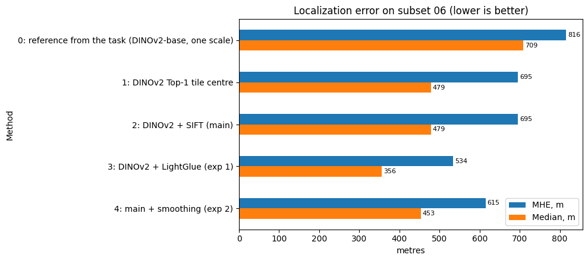
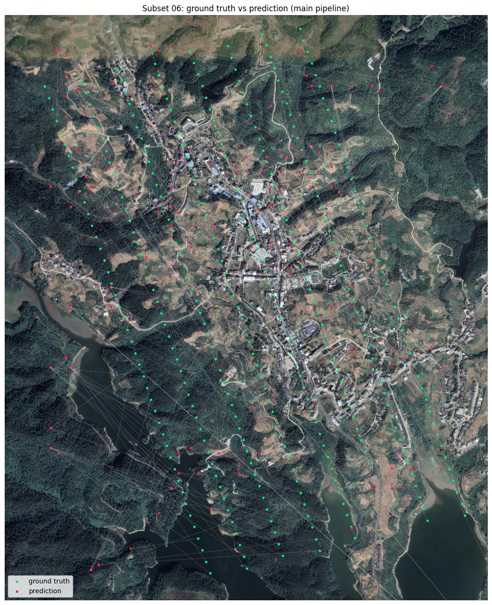
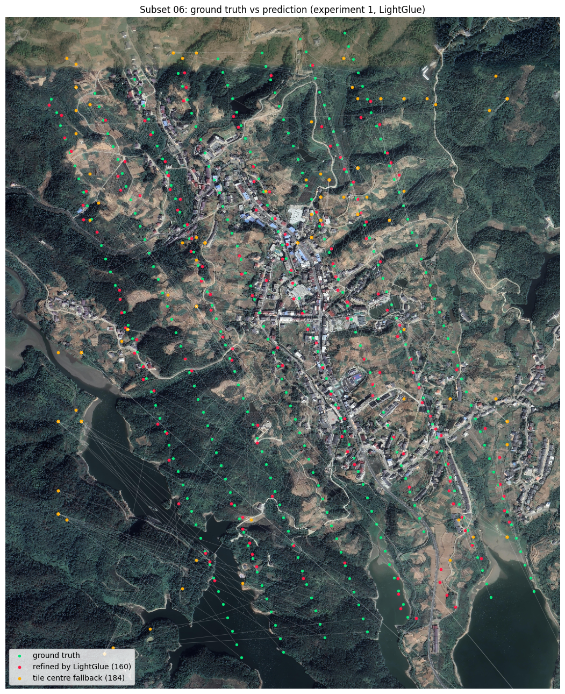
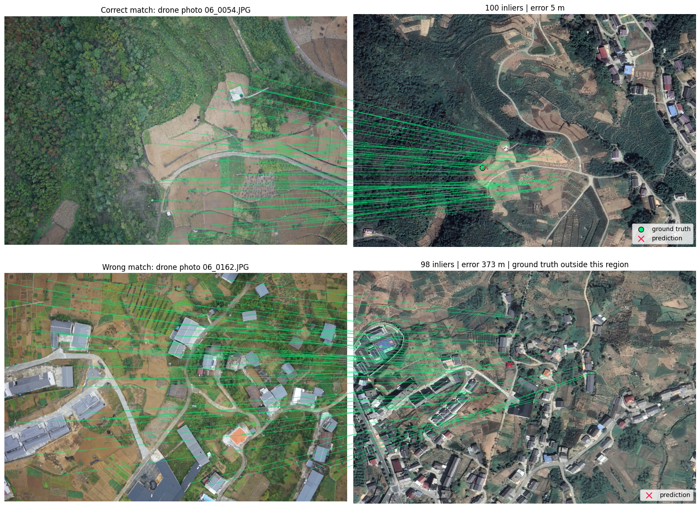
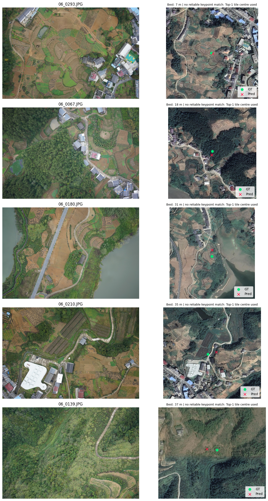
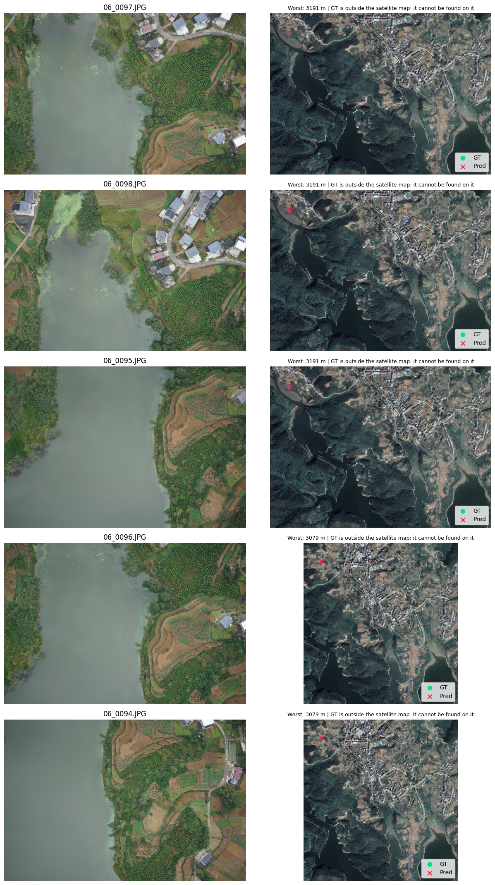

# UAV Visual Localization | DINOv2, SIFT, LightGlue

Finding where a drone photo was taken by matching it against one large satellite map ([UAV-VisLoc](https://github.com/IntelliSensing/UAV-VisLoc), subset 06, 344 photos). Take-home assignment, reworked into a reproducible notebook. No training: pretrained models only.

      ![matplotlib](https://img.shields.io/badge/matplotlib-11557C?logo=data%3Aimage%2Fsvg%2Bxml%3Bbase64%2CPHN2ZyB4bWxucz0iaHR0cDovL3d3dy53My5vcmcvMjAwMC9zdmciIHZpZXdCb3g9IjAgMCAyNTYgMjU2Ij48Y2lyY2xlIGN4PSIxMjgiIGN5PSIxMjgiIHI9IjExMCIgZmlsbD0ibm9uZSIgc3Ryb2tlPSIjZmZmIiBzdHJva2Utd2lkdGg9IjE0Ii8%2BPGc%2BPHBhdGggZmlsbD0iI2ZmZiIgZD0ibTEwNy44IDM2IC4xLjcgMjAuOCA5MS4xLTEuMy43LTU5LjktNzEuOC0uNS0uNi42LS41QTk0IDk0IDAgMCAxIDEwNyAzNi4xeiIvPjxwYXRoIGZpbGw9IiNmZmYiIGQ9Im01NCA5MS41LjYuMyA3My43IDM1LjUtLjIgMS40LTgwLjUgMTQuNi0uNy4yLS4xLS44YTgzIDgzIDAgMCAxIDYuOC01MC41eiIvPjxwYXRoIGZpbGw9IiNmZmYiIGQ9Im0xMjcuNyAxMjcuMy43IDEuM0w5MCAxNTUuMmwtLjYuNS0uNC0uNmE0OCA0OCAwIDAgMS0zLjgtNi41bC0uMy0uNy43LS4zeiIvPjxwYXRoIGZpbGw9IiNmZmYiIGQ9Im0xMjguNyAxMjcuOSA5LjggNTcuNi4yLjctLjguMmE1OSA1OSAwIDAgMS0yMy0uN2wtLjgtLjIuMi0uNyAxMy01N3oiLz48cGF0aCBmaWxsPSIjZmZmIiBkPSJtMTI4LjUgMTI3LjQgNzMuNyA1Ny41LjYuNC0uNS42YTk0IDk0IDAgMCAxLTE1LjUgMTUuOGwtLjYuNS0uNS0uNi01OC4zLTczLjF6Ii8%2BPHBhdGggZmlsbD0iI2ZmZiIgZD0ibTE1MC43IDExOS44LjIuN2EyNCAyNCAwIDAgMSAxLjIgNy41di44aC0yMy42bC4xLTEuOCAyMS40LTd6Ii8%2BPHBhdGggZmlsbD0iI2ZmZiIgZD0ibTE1Mi4yIDYxLjQuNy4yYTcxIDcxIDAgMCAxIDE5LjMgMTFsLjYuNS0uNS41LTQzLjcgNTQuOS0xLjMtLjggMjQuNi02NS42eiIvPjwvZz48Y2lyY2xlIGN4PSIxMjgiIGN5PSIxMjgiIHI9IjYiIGZpbGw9IiNmZmYiLz48L3N2Zz4%3D&style=for-the-badge)

## 📊 Results

Test set: subset 06, 344 drone photos; its GPS labels are read only in the final evaluation. Main metric: Mean Haversine Error (MHE, lower is better).

| Method | MHE, m | Median, m | P90, m | ≤ 50 m | ≤ 500 m |
|---|---|---|---|---|---|
| Reference from the task (DINOv2-base, one tile scale) | 816 | 709 | 1557 | – | – |
| DINOv2, centre of the Top-1 tile | 695 | 479 | 1483 | 2.3% | 50.9% |
| DINOv2 + SIFT refinement (main) | 695 | 479 | 1483 | 2.3% | 50.9% |
| **DINOv2 + SuperPoint/LightGlue refinement (exp 1)** | **534** | 356 | 1335 | 32.8% | 64.5% |
| Main + smoothing over 5 frames (exp 2) | 615 | 453 | 1271 | 3.5% | 54.1% |

**Bold** = best result. The main pipeline was fixed before the evaluation; each experiment changes one thing in it.

- **Better retrieval beats the reference:** multi-scale tiles in the drone-photo shape, a 180° rotation and overlapping tiles bring MHE from 816 to 695 m.
- **SIFT never passed the acceptance checks** (0 of 344 photos), so the main pipeline is in fact the tile centre. Drone and satellite images differ in season, light and viewpoint, and much of the area is forest, water and fields.
- **SuperPoint + LightGlue works where SIFT fails:** 160 of 344 photos were refined (median 99 inliers). MHE drops to 534 m, and the share of photos within 50 m rises from 2.3% to 32.8%. Most accepted matches are precise, but repeated buildings can still produce a confident wrong match.
- **Smoothing over neighbouring frames** removes large jumps of the prediction (P90 1483 → 1271 m), using only the order of the file names.
- **6 photos cannot be localized at all:** their GPS position is outside the satellite map. They still count in the MHE.

<!-- >>> IMAGE: put errors_bars.png (from the Kaggle notebook's Output tab, folder outputs/) into the images/ folder <<< -->

*MHE and median error of every method; the task's reference on top.*

<!-- >>> IMAGE: put map_gt_vs_pred.png (from the Kaggle notebook's Output tab, folder outputs/) into the images/ folder <<< -->

*Main pipeline on the satellite map: green = GPS ground truth, red = prediction, white line = error.*

<!-- >>> IMAGE: put map_lightglue.png (from the Kaggle notebook's Output tab, folder outputs/) into the images/ folder <<< -->

*Experiment 1 on the map: red points were refined by LightGlue (160), orange ones fell back to the tile centre (184).*

<!-- >>> IMAGE: put lightglue_match.png (from the Kaggle notebook's Output tab, folder outputs/) into the images/ folder <<< -->

*LightGlue matches between the drone photo (left) and the map (right). Top: a correct match, error 5 m. Bottom: a wrong match on similar buildings elsewhere, error 373 m.*

<!-- >>> IMAGE: put best5.png (from the Kaggle notebook's Output tab, folder outputs/) into the images/ folder <<< -->

*Five best predictions of the main pipeline: drone photo (left) and the map around it (right).*

<!-- >>> IMAGE: put worst5.png (from the Kaggle notebook's Output tab, folder outputs/) into the images/ folder <<< -->

*Five worst predictions: the largest errors come from photos whose GPS position lies outside the satellite map.*

## 🛠️ Approach

1. **Tiles.** The 8082×9780 px map is cut into tiles at three scales (3:2, like the drone photos) with a 336 px stride; each tile is also rotated by 180°, because the drone's heading is unknown.
2. **Coarse retrieval.** DINOv2 ViT-B/14 embeds photos and tiles; cosine similarity picks the 8 most similar, spatially distinct tiles.
3. **Refinement.** Keypoints of the photo are matched with a 2500×1700 px map region around each candidate, a MAGSAC++ homography projects the photo centre onto the map, and strict checks (matches, inliers, inlier share) decide whether to trust it. Otherwise the centre of the best tile is used.
4. **Coordinates.** Map pixels are converted to latitude and longitude with the map bounds.
5. **Experiments.** (1) SuperPoint + LightGlue instead of SIFT, with the same thresholds; (2) median of the predictions over 5 neighbouring frames. Settings were fixed in advance, not tuned on the test set.

## 📏 Metric

MHE is the mean great-circle (haversine) distance between predicted and true GPS positions over all 344 photos. Median, P90 and the share of photos within 50 m and 500 m show how the errors are distributed.

## ⚠️ Limitations

- Subset 06 is test-only, so nothing could be validated: the experiments are reported next to the main pipeline, not used to pick a winner, and their combination (LightGlue + smoothing) was not evaluated.
- One run, no fine-tuning; when refinement fails, accuracy is limited by the tile grid.
- Retrieval hit rates (Top-1 25.6%, Top-5 48.5%) are not directly comparable with the reference, because our tiles are larger.

**Next steps:** use the other subsets of the dataset as a validation set to choose the matcher, thresholds and smoothing honestly, and fine-tune the retrieval model on drone/satellite pairs.

## ▶️ How to run

Open the notebook on Kaggle with the dataset `hailong1610/uav-visloc-dataset` (Apache-2.0) attached, enable GPU and Internet, and Run All (about 1.5 hours; SIFT refinement alone takes about an hour).
Outputs in `/kaggle/working/outputs`: `metrics_06.csv`, `predictions_06.csv`, per-method pixel predictions and the figures above.
